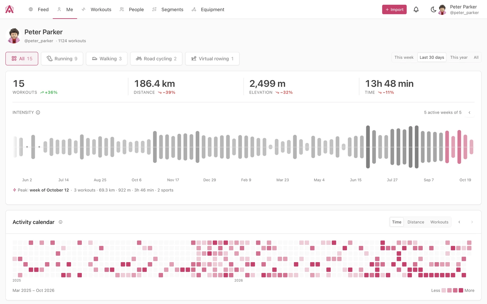
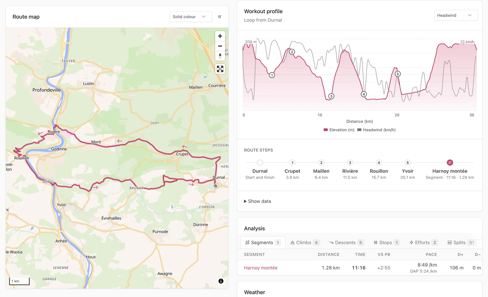

# Allure

**Your activities, your server, your federation.**

Allure is a self-hosted sport-tracking application. Import the activities your
watch, bike computer or phone records, read a detailed analysis of every
outing, and share exactly what you choose with the people you choose: your
followers, the members of your instance, or followers on other Allure
instances over ActivityPub.

- **Try it:** <https://demo.allure.rocks> — the credentials are on the sign-in
  page. The instance is reset every night; never import personal data.
- **Install it:** <https://docs.allure.rocks>
- **Images:** `allurerocks/allure` and `allurerocks/allure-route-image` on
  [Docker Hub](https://hub.docker.com/r/allurerocks/allure).

## Why Allure

- **Nothing is shared until you publish.** An imported activity is private.
  Publishing freezes a sanitized copy: privacy zones are cut from the route
  before the copy is made, the publishing profile decides which figures go out,
  and heart rate is not among them by default.
- **Members only.** Every page except sign-in and registration needs an account.
  Registration is closed by default in production; invitations open it.
- **Your data stays yours.** Any member can export everything — original files
  included, in a re-importable archive — and delete their account without
  asking the operator.
- **Your server, your rules.** No analytics, no advertising, no Redis. Every
  third-party service — geocoding, terrain elevation, weather, remote imports,
  push notifications, federation — is off until the operator turns it on.
- **Federated, not broadcast.** A publication reaches the instances its readers
  are on; it is never announced to the whole network.

## Features

### Analysis

- Maps on vector basemaps, light and dark, with direction arrows and colouring
  by elevation, speed or power.
- Elevation, speed, heart-rate, cadence and power profiles, synchronised with
  the map.
- Splits, recorded laps and derived smart laps — loops, climbs, descents,
  stops, pauses and intervals — named after the places they pass.
- Best efforts over standard distances, and personal records per sport.
- Heart-rate zones, training load (fitness, fatigue, form) and zone
  distribution.
- A data-quality pass that flags readings which look wrong — GPS jumps,
  implausible speed, frozen heart rate — without silently correcting them.
- Optional terrain elevation, historical weather and wind exposure along the
  route.
- 38 sports, including virtual rides, runs and rowing, whose worlds are drawn
  on their own map.

### Segments and routes

- Segments, routes and loops, matched automatically against your history.
- Leaderboards served according to what each reader may see, with optional
  women and men categories.
- Progression charts of your own times on a segment, and a suggestion when you
  start repeating a route.

### Social

- A feed, follows — each request approved by hand — comments with replies,
  and reactions.
- Outings done together: invite a partner, credit their totals or link your own
  recording; with both accounts' consent, Allure suggests them automatically.
- Photos placed along the route, shared only when you choose.
- Scheduled publishing, with a safety delay before going live, and opt-in
  automatic publishing.
- Five languages — English, French, German, Spanish, Dutch — and metric or
  imperial units.

### Operation

- An administration console: dashboard, background jobs, federation, accounts,
  invitations, imports and the audit log.
- Prometheus metrics at `/metrics`, with a ready-made Grafana dashboard.
- Sign-in hardening: two-step verification with an authenticator app, a passkey
  or recovery codes, and Google, Apple or any OpenID Connect provider.

## Imports

| Source | How |
|---|---|
| GPX, FIT and TCX files | one at a time, in batches, or as ZIP and `.gz` archives |
| Strava | the full account export archive, with names, gear, notes and photos |
| Garmin Connect | a linked account, synchronised automatically |
| Withings, Zwift, EXR | a linked account |
| iGPSPORT bike computers | over Bluetooth from Chrome or Edge |
| Manual entry | for sessions with no file |

Garmin Connect, Withings, Zwift and EXR are operator options: each appears only
when the instance enables it. An indoor recording without GPS — trainer,
treadmill, erg, pool — imports and analyses like any other.

## Federation

| Peer | Status |
|---|---|
| Allure ↔ Allure | Public and followers-only publications, media, courses, comments, reactions and shared outings |
| Mastodon and other ActivityPub software | Planned |
| [Wanderer](https://wanderer.to) | Planned (trails and route planning) |

Federation is off by default. The operator enables it, and the followers-only
audience sits behind a switch of its own.

## Self-hosting

A Linux host (amd64 or arm64) with Docker Compose, at least 4 GB of memory and
two cores, a stable public hostname behind a TLS reverse proxy, and outgoing
mail. The images come from Docker Hub, so nothing is compiled on the server.

The [quick start](https://docs.allure.rocks/install/quick-start) takes an empty
server to its first account in about five minutes. The
[architecture guide](https://docs.allure.rocks/guide/architecture) lists every
container and every third party an instance may contact.

## For developers

- A versioned REST API under `/api/rest/v1`, with scoped personal tokens and an
  OpenAPI 3.1 document rendered on every instance at `/developers/api`.
- Signed webhooks (Standard Webhooks) for the same events.
- An MCP endpoint, so an AI assistant can read a member's workouts. Coordinates
  leave the instance only at the level chosen when the token is created.

## Project status

Allure is pre-1.0: minor releases may still change an interface. The current
release is 0.10.0; [CHANGELOG.md](CHANGELOG.md) lists what changed in each one.

## Contributing

Contributions are welcome. Read [CONTRIBUTING.md](CONTRIBUTING.md) for the
development environment, the demo dataset, the checks and the DCO sign-off, and
[SECURITY.md](SECURITY.md) to report a vulnerability privately. The design
reference is [docs/dev/DESIGN.md](docs/dev/DESIGN.md), and
[AGENTS.md](AGENTS.md) is the repository guide for contributors and coding
agents. Where a contract is not published yet, those files mark it
`[devdoc:<topic>]` and the pull request explains it until the document lands.

## Credits

Allure is an independent project, not a fork of any of these. Their behaviour
informed the design; their code is not included.

- [FitTrackee](https://codeberg.org/FitTrackee/FitTrackee) (AGPL-3.0) — the
  workout-tracking model: file import, metrics, visibility and the shape of the
  activity pages.
- [FitPub](https://codeberg.org/fitpub/fitpub) (AGPL-3.0-or-later) — the
  ActivityPub model: publication delivery, idempotency, tombstones and privacy
  zones.
- [Endurain](https://github.com/endurain-project/endurain) (AGPL-3.0) — the
  activity-media model (a path and a type, thumbnails, positions on the map,
  the gallery and lightbox) and the reference for the remote import model
  (Garmin Connect).
- [Wanderer](https://wanderer.to) (AGPL-3.0) — the trail and route-planning
  vocabulary Allure targets for interoperability.

The optional FIT conformance corpus, used by the development seed and the
parser specs, comes from
[ThomasKuehne/FIT-test-files](https://github.com/ThomasKuehne/FIT-test-files);
it is fetched on demand, never committed, and remains under its own terms.

Third-party components that ship with Allure — Font Awesome Free, Meteocons,
Tabler, MapLibre, Apache ECharts, the Garmin Connect port, the Zwift world data
and the FIT profile tables — are credited in [`NOTICE`](NOTICE).

Built with Ruby on Rails, PostgreSQL and PostGIS, Hotwire, Tabler, MapLibre and
Apache ECharts: no Redis, no single-page framework.

## Licence

AGPL-3.0-or-later (see [`LICENSE`](LICENSE)); the documentation is under the
same licence. Third-party components and their attributions are listed in
[`NOTICE`](NOTICE). The UI is built on Tabler (MIT); no commercially licensed
theme assets are included, which is what keeps this repository distributable.
